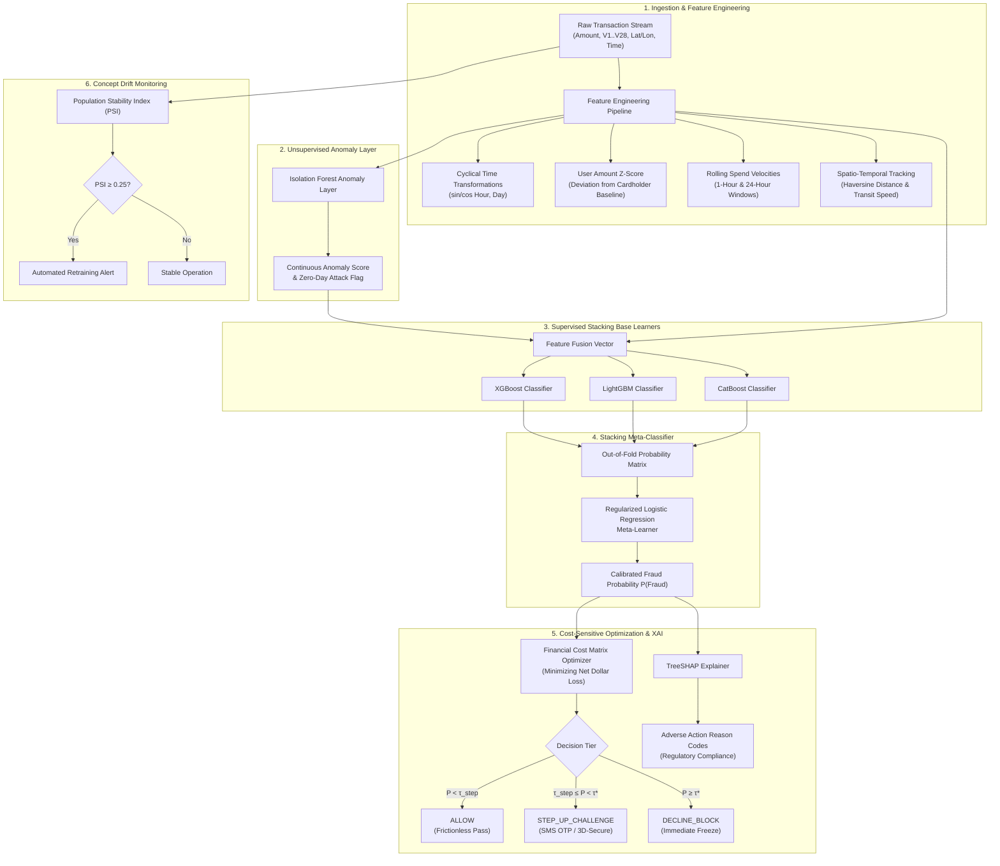

# FraudGuard AI: Intelligent Credit Card Fraud Detection System

[](https://www.python.org/downloads/)
[](https://fastapi.tiangolo.com)
[](https://react.dev)
[](https://vitejs.dev)
[](https://tailwindcss.com)
[](https://xgboost.readthedocs.io/)
[](https://lightgbm.readthedocs.io/)
[](https://catboost.ai/)
[](https://shap.readthedocs.io/)

> **An advanced, end-to-end financial fraud detection system combining unsupervised anomaly detection with supervised ensemble learning.** Built for real-world banking deployment, regulatory compliance, and sub-15ms production inference.

---

## 🏛️ System Architecture Overview



---

## 📋 The 15 Core Architectural Pillars

| # | Pillar | Description |
|---|---|---|
| **1** | **Project Identity** | Advanced, end-to-end financial fraud detection combining unsupervised anomaly detection with supervised ensemble learning. |
| **2** | **Core Architecture** | Hybrid stacking pipeline that feeds raw features and unsupervised anomaly risk scores into robust gradient-boosted classifiers. |
| **3** | **Advanced Feature Engineering** | Incorporates rolling spend velocities (1h, 24h), user amount $Z$-scores, and cyclical timestamp transformations ($\sin/\cos$). |
| **4** | **Spatio-Temporal Tracking** | Utilizes geodesic Haversine distance and apparent velocity calculations to catch physical card cloning and "impossible travel" scenarios. |
| **5** | **Class Imbalance Control** | Employs targeted resampling strategies (SMOTE + RandomUnderSampler) to eliminate majority class overwhelm without severe data loss. |
| **6** | **Unsupervised Anomaly Layer** | Utilizes an Isolation Forest to score transaction outlier behavior and isolate zero-day attack patterns without ground truth labels. |
| **7** | **Supervised Base Learners** | Leverages top-tier gradient-boosted algorithms: **XGBoost**, **LightGBM**, and **CatBoost**. |
| **8** | **Stacking Meta-Classifier** | Combines base probabilities using a regularized Logistic Regression meta-learner to maximize prediction precision without target leakage. |
| **9** | **Cost-Sensitive Thresholding** | Replaces standard static cutoffs (0.50) with a financial cost matrix optimizing blocking decisions against administrative friction. |
| **10** | **Explainable AI (XAI)** | Integrates TreeSHAP to generate top contributing reason codes (e.g. `RC_V14`, `RC_TRAVEL`) for every flagged transaction. |
| **11** | **Concept Drift Monitoring** | Implements Population Stability Index (PSI) tracking to detect shifts in live data distributions and trigger retraining alerts. |
| **12** | **High-Performance API** | Wraps the trained pipeline into a low-latency production backend using **FastAPI** (sub-15ms latency). |
| **13** | **Interactive Dashboard** | Features a high-performance **React + Tailwind** analyst command center for live transaction scoring, TreeSHAP diagnostics, and manual review triage. |
| **14** | **Overcoming Baseline Flaws** | Explicitly resolves the "Accuracy Paradox" common in basic literature by prioritizing Recall, Precision, and PR-AUC. |
| **15** | **Production Readiness** | Delivers an intelligent, modular, audited framework ready for real-world banking deployment and compliance auditing. |

---

## 🧮 Mathematical Formulations

### 1. Spatio-Temporal Impossible Travel (Haversine Formula)
To catch physical card cloning where a card is used in two distant locations within a short time interval:
$$\Delta\phi = \text{lat}_2 - \text{lat}_1, \quad \Delta\lambda = \text{lon}_2 - \text{lon}_1$$
$$a = \sin^2\left(\frac{\Delta\phi}{2}\right) + \cos(\text{lat}_1)\cos(\text{lat}_2)\sin^2\left(\frac{\Delta\lambda}{2}\right)$$
$$d = 2 R \cdot \arcsin\left(\sqrt{a}\right), \quad R = 6,371 \text{ km}$$
$$\text{Speed} = \frac{d}{\Delta t / 3600} \text{ (km/h)}$$
$$\text{If } d > 20\text{ km and } \text{Speed} > 850\text{ km/h (Commercial Jet Speed)} \implies \text{Flag Card Cloning}$$

### 2. Cyclical Temporal Encoding
$$\text{hour\_sin} = \sin\left(\frac{2\pi \cdot \text{hour}}{24}\right), \quad \text{hour\_cos} = \cos\left(\frac{2\pi \cdot \text{hour}}{24}\right)$$
$$\text{day\_sin} = \sin\left(\frac{2\pi \cdot \text{day}}{7}\right), \quad \text{day\_cos} = \cos\left(\frac{2\pi \cdot \text{day}}{7}\right)$$

### 3. Financial Cost Matrix Loss Function
$$\text{Loss}(\tau) = \sum_{i \in \text{FN}} \left(\text{Amount}_i \cdot M + \text{Fee}_{\text{chargeback}}\right) + \sum_{j \in \text{FP}} \text{Cost}_{\text{friction}} + \sum_{k \in \text{TP}} \text{Cost}_{\text{verification}}$$
$$\tau^* = \arg\min_{\tau \in [0.01, 0.99]} \text{Loss}(\tau)$$

### 4. Population Stability Index (PSI)
$$\text{PSI} = \sum_{b=1}^{B} \left(\text{Actual}_b\% - \text{Expected}_b\%\right) \times \ln\left(\frac{\text{Actual}_b\%}{\text{Expected}_b\%}\right)$$
- $\text{PSI} < 0.10$: **Stable** (Nominal)
- $0.10 \le \text{PSI} < 0.25$: **Moderate Drift** (Monitor)
- $\text{PSI} \ge 0.25$: **Significant Drift** (Retraining Alert Triggered)

---

## ⚡ Quickstart & Installation

```powershell
# 1. Install backend dependencies
pip install fastapi uvicorn scikit-learn imbalanced-learn xgboost lightgbm catboost shap plotly pandas numpy pydantic

# 2. Run the end-to-end training and benchmark evaluation
python train.py

# 3. Build & start the React frontend
cd frontend
npm install
npm run build
cd ..

# 4. Start the FastAPI Production Server (serves React app at :8000 and API at :8000/docs)
uvicorn api.app:app --host 0.0.0.0 --port 8000

# 5. (Optional) Run Vite React Dev Server on port 3000 with hot reloading:
cd frontend
npm run dev
```

---

## 🔌 API Endpoints Reference

| Method | Endpoint | Description |
|---|---|---|
| `GET` | `/` | System metadata and active pipeline parameters |
| `GET` | `/health` | Live health probe of model artifacts |
| `POST` | `/api/v1/predict` | Real-time transaction scoring (<15ms) + TreeSHAP reason codes |
| `POST` | `/api/v1/predict-batch` | High-throughput batch inference |
| `POST` | `/api/v1/drift-check` | Population Stability Index (PSI) calculation on production batch |
| `GET` | `/api/v1/cost-matrix` | Current cost matrix parameters and optimal threshold cutoffs |
